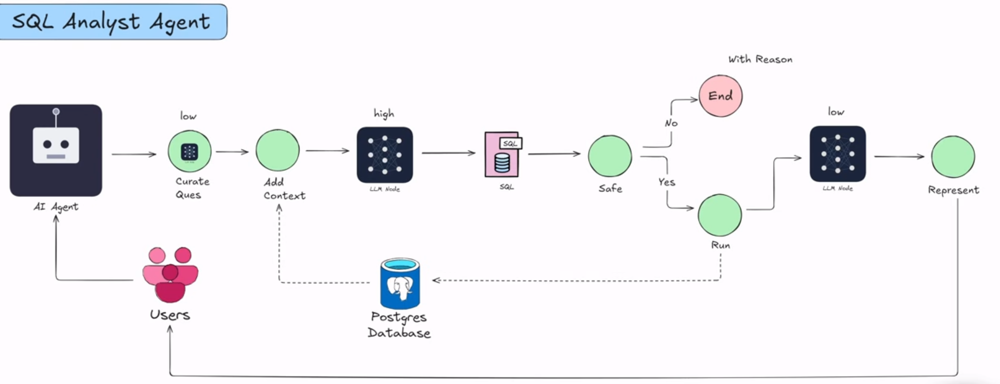
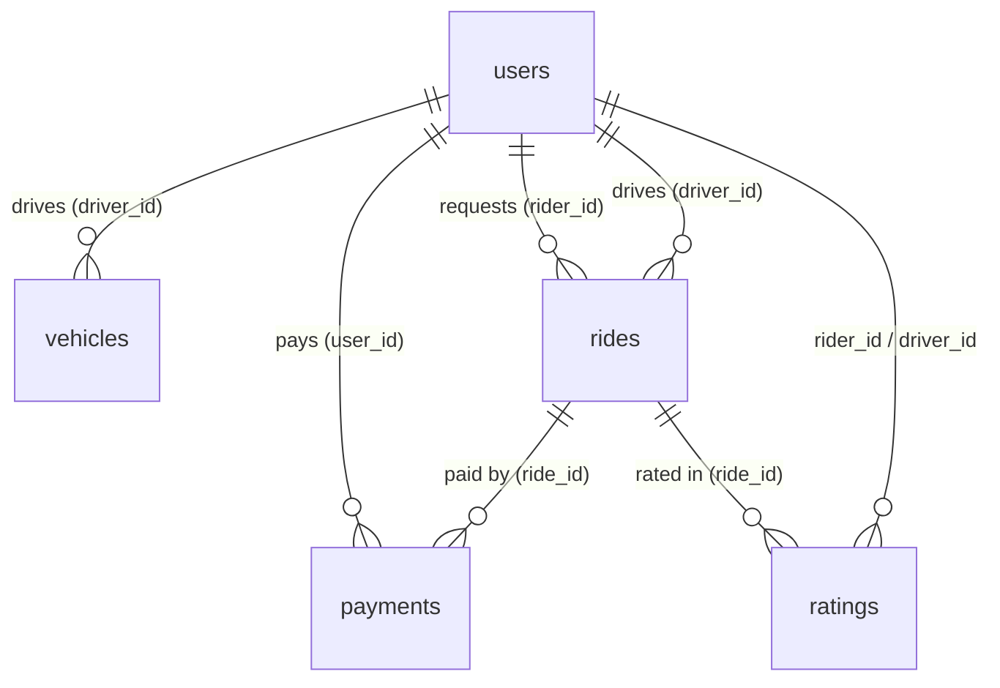

# SQL Analyst Agent

Ask a question about your data in plain English and get an answer back, with no SQL needed.

```
You:    "What are the different types of payment methods we have in our database?"

Agent:  The payment methods currently available are:
        - Apple Pay
        - Credit card
        - Debit card
        - Google Pay
        - PayPal
```

Behind the scenes, the agent rewrites your question, looks at the database structure, writes a SQL query, has a second LLM check that the query is safe, runs it on PostgreSQL, and turns the raw rows into a readable answer.

It's built with **LangGraph** (the agent workflow), **LangChain + OpenAI** (the LLM calls), **Pydantic** (typed state and structured output) and **PostgreSQL** (the data), using a fake rideshare dataset.

---

## Table of contents

1. [Architecture](#architecture)
2. [Project structure](#project-structure)
3. [Setup and running](#setup-and-running)
4. [The dataset](#the-dataset)
5. [How the agent works, node by node](#how-the-agent-works-node-by-node)
6. [Learning notes](#learning-notes)
7. [Debugging journal: bugs found and what they taught](#debugging-journal-bugs-found-and-what-they-taught)
8. [Known limitations and next steps](#known-limitations-and-next-steps)

---

## Architecture



The same flow, as LangGraph draws it from the code (`sql_analyst_graph.png`, generated on every run):


```
START
  -> curate_question        LLM (low)      rewrite the question clearly
  -> prompt_query_context   no LLM         build a prompt with the DB schema + sample rows
  -> generate_sql           LLM (medium)   write the SQL query
  -> is_safe_sql            LLM (medium)   judge: is the query read-only?
       |-- "Yes" -> execute_sql                  run it on Postgres
       |              -> represent_final_answer  LLM (low) explain the result
       |              -> END
       |-- "No"  -> canceled_sql                 stop and explain why
                      -> END
```

> The architecture sketch marks the SQL step as "high". The code currently uses the `medium` model for it (see `utils/llm_pick.py`).

---

## Project structure

```
data_agent/
├── agents/
│   ├── sql_analyst.py      # the agent: nodes, edges, graph, and a runnable example
│   └── scratch_pad.py      # playground to test the safety judge on its own
├── models/
│   └── schema.py           # Pydantic models: AgentSchema (graph state), JudgeSchema (judge output)
├── utils/
│   ├── database.py         # DatabaseUtil: describe a schema as text, run a query
│   └── llm_pick.py         # pick_llm("low" | "medium" | "advanced") -> ChatOpenAI model
├── data/                   # rideshare CSVs (users, vehicles, rides, payments, ratings)
├── feed_db.py              # creates the tables and loads the CSVs into Postgres
├── schema_details.txt      # what the LLM "sees" about the DB (generated by utils/database.py)
├── architecture.png        # hand-drawn architecture
├── sql_analyst_graph.png   # graph diagram generated by LangGraph
├── main.py                 # (empty, reserved for a future entry point)
├── pyproject.toml / uv.lock
└── .env                    # secrets, not committed
```

---

## Setup and running

### 1. Requirements

- Python 3.11+
- [uv](https://docs.astral.sh/uv/) (package manager)
- A running PostgreSQL server
- An OpenAI API key

### 2. Install dependencies

```bash
uv sync
```

`uv sync` reads `pyproject.toml` / `uv.lock` and creates `.venv` with the exact versions.
`uv run <file>` then runs a script inside that environment, so there's no need to activate it.

### 3. Create `.env`

```dotenv
OPENAI_API_KEY=sk-...

POSTGRES_HOST=localhost
POSTGRES_PORT=5432
POSTGRES_DB=postgres
POSTGRES_USER=postgres
POSTGRES_PASSWORD=...
```

`.env` is in `.gitignore`. `load_dotenv()` reads it into `os.environ`, so passwords never appear in the code.

### 4. Load the data

```bash
uv run feed_db.py
```

```
Connected to PostgreSQL
Tables created successfully
Loaded users.csv
...
Record counts:
----------------------------------------
users               10,000
vehicles             3,000
rides               20,000
payments            16,073
ratings             12,000
```

The script empties the tables first, so you can re-run it any time to reset the data.

### 5. (Optional) See what the LLM will see

```bash
uv run utils/database.py      # writes schema_details.txt
uv run utils/llm_pick.py      # checks the OpenAI key works
uv run agents/scratch_pad.py  # tries the safety judge alone
```

### 6. Run the agent

```bash
uv run agents/sql_analyst.py
```

To ask something else, change `user_input` in the `input_schema` at the bottom of `agents/sql_analyst.py`.

---

## The dataset

A fake rideshare company (Canadian cities), stored in the Postgres schema `rideshare`.



| Table | Rows | What it holds |
|---|---|---|
| `users` | 10,000 | riders (7,000) **and** drivers (3,000), told apart by `user_type` |
| `vehicles` | 3,000 | one per driver: make, model, year, plate, colour |
| `rides` | 20,000 | times, GPS coordinates, distance, fare, surge, `status` (completed / cancelled / in_progress / requested) |
| `payments` | 16,073 | amount, `payment_method`, `payment_status`, transaction id |
| `ratings` | 12,000 | 1–5 stars + comment, linking rider, driver and ride |

Example questions to try:

- *Which 5 drivers have the highest average rating?*
- *What is the average fare by city?*
- *What percentage of rides were cancelled, and what are the most common reasons?*
- *Which payment method brings in the most revenue?*

---

## How the agent works, node by node

All nodes share one **state** object (`AgentSchema` in `models/schema.py`). Each node reads what it needs and returns a dict with only the fields it changed.

| # | Node | Reads | Writes | LLM | Why |
|---|---|---|---|---|---|
| 1 | `curate_question` | `user_input` | `curated_question`, `messages` | low | Vague questions make bad SQL. Rewording is easy, so a cheap model is enough. |
| 2 | `prompt_query_context` | `curated_question` | `prompt_query_context` | — | Pulls tables, columns, types and 5 sample rows per table from Postgres and puts them in the prompt. **This is what makes the SQL correct.** |
| 3 | `generate_sql` | `prompt_query_context` | `generated_sql_query` | medium | The hardest step: needs correct joins, filters, aggregations. |
| 4 | `is_safe_sql` | `generated_sql_query` | `is_safe`, `comments` | medium | A second LLM acts as a judge: is the query read-only? |
| 5a | `canceled_sql` | `comments` | `final_answer`, `messages` | — | "No" branch: stop and explain why. |
| 5b | `execute_sql` | `generated_sql_query` | `sql_query_execution_result` | — | "Yes" branch: run on Postgres. Errors come back as text. |
| 6 | `represent_final_answer` | result + question | `final_answer`, `messages` | low | Turns `[('apple_pay',), ...]` into a friendly sentence. |

The branch after node 4 is a **conditional edge**: the `is_safe_condition` function looks at `state.is_safe` and returns the name of the next node.

---

## Learning notes

### 1. What makes this an "agent" and not just one LLM call?

A single prompt like *"write SQL for this question"* fails often: the model guesses table names, nothing checks its output, and you get raw tuples back. An agent splits the job into **steps**, each with one responsibility, and adds **decisions** (the safety branch). Each step is small, testable, and can use a different model.

This project is a **workflow agent**: the path is fixed by the graph, and the LLM only decides content (the SQL) and one branch (safe / unsafe). A more autonomous agent would let the LLM choose which tool to call next, or retry after an error.

### 2. LangGraph basics

| Concept | In this project |
|---|---|
| **State** | `AgentSchema`: a Pydantic model that every node receives |
| **Node** | a plain Python function `state -> dict` |
| **Edge** | `add_edge("a", "b")`: after `a`, always run `b` |
| **Conditional edge** | `add_conditional_edges("is_safe_sql", is_safe_condition, [...])`: a router function picks the next node |
| **START / END** | special entry and exit points |
| **compile()** | checks the graph and returns a runnable with `.invoke()` |
| **draw_mermaid_png()** | renders the graph as an image |

**Reducers: how updates are merged.** By default, a field a node returns *replaces* the old value. A field declared as `Annotated[list, add]` *appends* instead:

```python
messages: Annotated[list, add]          # in AgentSchema

return {"messages": [AIMessage("hi")]}  # in a node: the new message is appended
```

That's why a node must return **only the new messages**. If it returned the whole list, everything would be appended again (see the debugging journal below).

### 3. Pydantic: typed state and validation

- `BaseModel` validates data when an object is created. A wrong type raises `ValidationError` immediately, instead of a mystery bug three nodes later.
- `Field(...)` means required. `Field(None)` means optional, starting as `None`.
- `Literal["Yes", "No"]` allows exactly those two strings, nothing else.
- LangGraph validates the **initial input** against the state model too, so a placeholder like `is_safe: ""` fails before the first node runs.

### 4. Structured output: making LLM answers machine-readable

```python
llm_judge = llm.with_structured_output(JudgeSchema)
verdict = llm_judge.invoke(prompt)      # -> JudgeSchema(is_safe="Yes", comments="...")
```

Instead of parsing free text (*"I think this is probably safe..."*), LangChain sends the Pydantic schema to the model and parses the reply back into an object. The `description=` of each field is sent too, so field descriptions act as instructions. `.model_dump()` turns the object into a dict.

### 5. Context is everything (prompt engineering for text-to-SQL)

The LLM has never seen your database. The prompt in `prompt_query_context` gives it:

- **a role**: "You are an SQL analyst agent"
- **the schema**: tables, columns, data types (from `information_schema`)
- **sample rows**: these teach the exact values (`'credit_card'` not `'Credit Card'`, `'completed'` not `'done'`), date formats, ID ranges
- **guardrails**: `LIMIT 10` by default, prefix tables with `rideshare.`
- **an output contract**: "only SQL, no explanation", because the reply is executed as-is

You can open `schema_details.txt` to see exactly the context the model gets.

### 6. LLM-as-a-judge and defence in depth

`is_safe_sql` uses a second LLM call to review the first one's output. It's a useful pattern (it also gives a human-readable reason), but **an LLM is not a security boundary**: it can be fooled or make mistakes. Real protection uses layers:

1. a database user with **read-only** (`SELECT`-only) permissions ← the strongest layer
2. a simple code check (e.g. reject anything that isn't a single `SELECT` / `WITH`)
3. the LLM judge for the fuzzy cases and the explanation
4. statement timeouts and row limits

### 7. Model tiering (cost vs quality)

`pick_llm(level)` maps a level to a model, so each step uses the cheapest model that does it well:

| Level | Used for | Why |
|---|---|---|
| `low` | rewording the question, writing the final answer | language tasks, easy |
| `medium` | writing SQL, judging safety | reasoning, must be correct |
| `advanced` | (not used yet) | for very complex queries |

All use `temperature=0`, for answers that are as repeatable as possible, which is what you want for SQL.

### 8. PostgreSQL concepts used here

- **Schema**: a namespace inside a database. Our tables are `rideshare.users`, `rideshare.rides`, …
- **search_path**: the list of schemas Postgres searches for unqualified names. The default is `public`, so `FROM payments` fails unless you write `rideshare.payments` or set `search_path=rideshare,public` (which `execute_sql` does).
- **information_schema**: built-in views that describe the database itself (tables, columns, types). Used to build the LLM context. `ordinal_position` gives the column order.
- **Primary / foreign keys, UNIQUE, CHECK**: rules Postgres enforces on every row (see `feed_db.py`).
- **Indexes**: speed up lookups and joins on the indexed columns.
- **COPY**: bulk-loads a CSV in one go, much faster than thousands of `INSERT`s.
- **Transactions**: `feed_db.py` turns autocommit off, so all loads are saved together by `conn.commit()`, or none are.
- **Connection vs cursor** (psycopg2): the connection is the session; the cursor sends SQL and holds results (`fetchall()` → list of tuples, `fetchone()` → one tuple).

### 9. Python notes

- **`sys.path.append(...)`** in `agents/*.py` lets a script inside `agents/` import `utils` and `models` from the project root. It's a workaround; the cleaner alternatives are `python -m agents.sql_analyst` or installing the project as a package.
- **`**dict`** unpacks a dict into keyword arguments: `psycopg2.connect(**{"host": "x"})` is the same as `psycopg2.connect(host="x")`.
- **`try / except / finally`**: `finally` always runs, which makes it the right place to close cursors and connections.
- **f-strings in SQL**: fine for values your code controls (the schema name), dangerous for user input (SQL injection). `feed_db.py` shows the safe way: `psycopg2.sql.Identifier`.
- **`if __name__ == "__main__":`**: code that runs only when the file is executed directly, not when it's imported. Every file here uses it for a quick self-test.

### 10. Running LLM-generated code: `execute_code` and production

`ETLTools.execute_code` (in `utils/etl_tools.py`) calls `exec(code)`. That code runs **inside the same Python process as the agent, on our server**, with the same permissions. It can:

- read `.env` and `os.environ` (OpenAI key, Postgres password)
- read, change or delete any file the process can reach
- open network connections (send data out, call internal services)
- install packages, start processes, use all the CPU/RAM, or loop forever and freeze the agent

That's fine for learning on your own machine. In production, the code comes from an LLM, and the LLM's input comes from users (and from API data), so a prompt injection can turn into arbitrary code running on the server. **Never `exec` LLM code in the app process in production.**

**How to do it in production: run the code in a sandbox, not on the server.**

| Option | What it is | When to pick it |
|---|---|---|
| Managed sandbox ([E2B](https://e2b.dev), [Modal](https://modal.com) sandboxes, [Daytona](https://daytona.io)) | an API call creates an isolated micro-VM, runs the code, returns stdout/files, destroys the VM | the easiest secure option; good default |
| Docker container per run | `docker run` a throwaway container with no network, read-only filesystem, CPU/RAM/time limits | you host everything yourself |
| gVisor / Firecracker | stronger isolation than plain Docker (a container shares the host kernel) | many untrusted users, higher risk |
| Don't run code at all | the LLM picks from fixed tools (`extract_load`, `transform`, …) with typed arguments | when the tasks are predictable; the safest option |

`RestrictedPython`, removing `__builtins__`, or a blocklist of words like `import os` **is not a sandbox**: there are well-known ways around all of them.

Example with Docker (each run gets a new container, which is thrown away at the end):

```python
import subprocess

def execute_code(code: str, data_dir: str) -> str:
    result = subprocess.run(
        [
            "docker", "run", "--rm",
            "--network", "none",              # no internet, no access to Postgres/internal services
            "--memory", "512m", "--cpus", "1",
            "--pids-limit", "64",
            "--read-only",                    # filesystem is read-only...
            "--tmpfs", "/tmp:size=64m",       # ...except a small /tmp
            "-v", f"{data_dir}:/data:ro",     # only the data it needs, read-only
            "--user", "1000:1000",            # not root
            "python-sandbox:latest",          # image with only pandas etc., no secrets
            "python", "-c", code,
        ],
        capture_output=True, text=True, timeout=30,
    )
    return result.stdout if result.returncode == 0 else f"Error: {result.stderr}"
```

Production checklist:

1. **Isolation**: separate VM/container per run, destroyed afterwards; never the agent's own process.
2. **No secrets inside**: no `.env`, no API keys, no DB credentials in the sandbox.
3. **No network** by default; if it's needed, an allowlist of domains.
4. **Limits**: timeout, memory, CPU, number of processes, output size.
5. **Least data**: mount only the files that run needs, read-only; outputs go to a separate folder you check before using them.
6. **Return the output**: capture stdout/stderr (the current `exec` version only returns "Code executed successfully", so the agent never sees the result).
7. **Logging**: store each piece of code that ran, who asked for it and the result, so you can audit it.
8. **Human approval** for anything that writes to real systems (DB, cloud storage).

---

## Debugging journal: bugs found and what they taught

| Symptom | Cause | Fix | Lesson |
|---|---|---|---|
| `schema_details.txt` was **3.7 GB**, full of repeated `Database Schema: rideshare` | `text += f"{text}..."` adds the whole string to itself on every line, so it **doubles** each time (2³⁰ ≈ 1 billion) | `text += f"..."` | `+=` already keeps the old value; don't also put it inside the f-string. |
| Sample row values didn't line up with column names | `information_schema.columns` has no guaranteed order | `ORDER BY ordinal_position` | SQL never guarantees row order without `ORDER BY`. |
| Columns from other schemas could appear | column query filtered by `table_name` only | added `AND table_schema = '...'` | the same table name can exist in several schemas. |
| `ValidationError: is_safe Input should be 'Yes' or 'No'` before the first node | initial input had `is_safe: ""`, which isn't allowed by `Literal["Yes","No"]` | made it `Literal[...] \| None = None` | LangGraph validates the input against the state model; fields filled later must allow an empty start value. |
| Conversation history would fill with duplicates | nodes returned the **whole** state; the `add` reducer appended the full `messages` list again | nodes return a dict of **only changed fields** | understand your reducers: return deltas, not full state. |
| A failed query would crash the graph | `execute_query` returned `None` on error, but the field is `str` | return `"Error executing query: ..."` | keep return types consistent; errors as data let the agent explain them. |
| `relation "payments" does not exist` | LLM wrote `FROM payments`; Postgres looked in `public` | `search_path=rideshare,public` + prompt tells LLM to prefix with `rideshare.` | fix it deterministically in code, and also guide the LLM. |

---

## Known limitations and next steps

**Limitations**

- The schema name `rideshare` is hard-coded in `prompt_query_context` and `execute_sql`.
- The whole schema (+ sample rows) is sent on every question. Fine for 5 tables, too big for 500.
- The LLM judge is the only safety layer; there's no read-only DB user yet.
- `ETLTools.execute_code` runs LLM code with `exec` inside the agent process, which is fine locally but not safe in production (see [learning note 10](#10-running-llm-generated-code-execute_code-and-production)).
- No retry: if the SQL fails, the agent explains the error but doesn't try to fix it.
- A new DB connection is opened per call, and `DatabaseUtil` closes it after one method call.
- If the DB connection fails, `execute_query` / `schema_details` hit a `NameError` on `cursor` in `finally`, hiding the real error.
- `pick_llm`'s error message mentions old level names (`basic/intermediate/advanced`).
- `OPENAI_MODEL` in `.env` isn't used.

**Ideas**

- **Self-correction loop**: if `execute_sql` returns an error, send the error back to `generate_sql` (a conditional edge pointing backwards), with a max of N retries.
- **Read-only Postgres role** for the agent.
- **Schema retrieval (RAG)**: pick only the tables relevant to the question before building the prompt.
- **Conversation memory**: use a LangGraph checkpointer so follow-ups like *"and by city?"* work.
- **Interface**: a CLI loop in `main.py`, or a small Streamlit/Gradio app.
- **Evaluation**: a set of questions with known answers to measure accuracy when changing prompts or models.
- **Charts**: let the final node return a chart when the result is a time series or a breakdown.
