# Data Agent

Ask for something in plain English, and a team of AI agents does it: answer a question from a database, download data from an API, or transform a data file.

```
You:    "What are the different types of payment methods we have in our database?"
Agent:  The available payment methods are: Apple Pay, Credit card, Debit card, Google Pay, PayPal.

You:    "Extract the data from https://pokeapi.co/api/v2/pokemon and save it to data/extracted as csv"
Agent:  Data was successfully extracted and saved as CSV at data/extracted/extracted_data.csv

You:    "Transform data/extracted/extracted_data.csv to show bulbasaur only, save it in data/transform"
Agent:  The data was filtered to Bulbasaur and saved as data/transform/transformed_data.csv
```

The project has **three agents**, and each one teaches a different pattern:

| Agent | File | Pattern | In one sentence |
|---|---|---|---|
| **Data Agent** | `agents/data_agent.py` | Router / orchestrator | Reads your request and sends it to the right specialist. |
| **SQL Analyst** | `agents/sql_analyst.py` | Fixed workflow | Turns a question into SQL, checks it's safe, runs it on Postgres and explains the result. |
| **ETL Analyst** | `agents/etl_analyst.py` | Tool-calling loop (ReAct) | Picks a tool (download or transform), runs it, looks at the result and decides what to do next. |

It's built with **LangGraph** (the agent workflows), **LangChain + OpenAI** (the LLM calls), **Pydantic** (typed state and structured output), **PostgreSQL** (the data) and **pandas** (files and tables).

---

## Table of contents

1. [The big picture](#1-the-big-picture)
2. [Project structure](#2-project-structure)
3. [Setup and running](#3-setup-and-running)
4. [The dataset](#4-the-dataset)
5. [Agent 1: Data Agent (router)](#5-agent-1-data-agent-router)
6. [Agent 2: SQL Analyst (workflow)](#6-agent-2-sql-analyst-workflow)
7. [Agent 3: ETL Analyst (ReAct loop)](#7-agent-3-etl-analyst-react-loop)
8. [Learning notes](#8-learning-notes)
9. [Debugging journal: bugs found and what they taught](#9-debugging-journal-bugs-found-and-what-they-taught)
10. [Known limitations and next steps](#10-known-limitations-and-next-steps)
11. [Glossary](#11-glossary)

---

## 1. The big picture

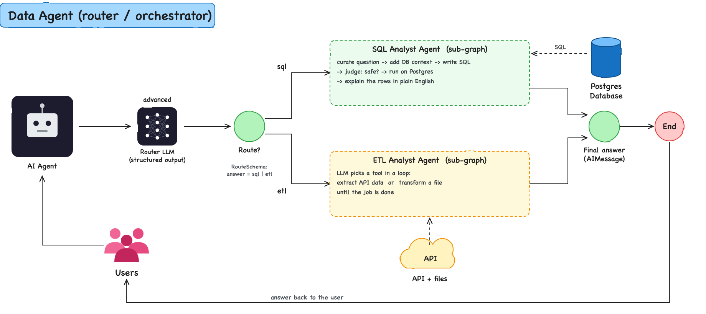

What happens when you run `uv run main.py`:

1. Your request goes to the **Data Agent**.
2. Its **router** (an LLM) answers one question: *is this about the database (`sql`) or about files/APIs (`etl`)?*
3. The request is handed to the specialist:
   - **SQL Analyst**: a fixed list of steps, always in the same order.
   - **ETL Analyst**: an LLM that chooses which tool to use, in a loop, until the job is done.
4. The specialist's answer comes back as the final message.

Each specialist is a complete LangGraph graph of its own. The Data Agent runs it inside one of its nodes, so it works as a **sub-graph**: the Data Agent doesn't need to know what happens inside.

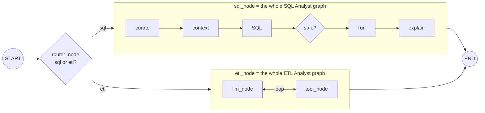

### Three ways to build an agent

|  | Who decides the next step? | Good for | Here |
|---|---|---|---|
| **Workflow** | Your code (fixed edges) | Predictable tasks where the steps are known | SQL Analyst |
| **ReAct / tool-calling** | The LLM, every turn | Open-ended tasks where the steps depend on the request | ETL Analyst |
| **Router** | The LLM, once, at the start | Sending different kinds of request to different specialists | Data Agent |

A workflow is easier to test and cheaper to run. A ReAct loop is more flexible, but it's harder to predict. Most real systems mix the two, as this project does.

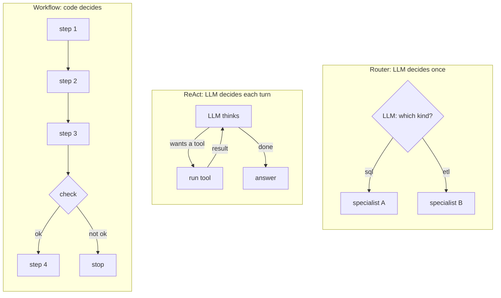

---

## 2. Project structure

```
data_agent/
├── main.py                  # entry point: sends one request to the Data Agent
├── agents/
│   ├── data_agent.py        # router: sql or etl? then calls the right sub-graph
│   ├── sql_analyst.py       # SQL workflow: question -> SQL -> safety check -> run -> answer
│   └── etl_analyst.py       # ReAct loop: LLM <-> tools (extract / transform)
├── models/
│   └── schema.py            # Pydantic models: the state of each graph + structured outputs
├── utils/
│   ├── llm_pick.py          # pick_llm("low" | "medium" | "advanced") -> ChatOpenAI model
│   ├── database.py          # DatabaseUtil: describe a schema as text, run a query
│   └── etl_tools.py         # ETLTools: download API data, read a file sample, run code
├── data/
│   ├── *.csv                # rideshare dataset (loaded into Postgres by feed_db.py)
│   ├── extracted/           # output of the ETL "extract" tool
│   └── transform/           # output of the ETL "transform" tool
├── img/
│   ├── architecture_*.png   # architecture diagrams, one per agent
│   ├── *_graph.png          # graph diagrams drawn by LangGraph (rewritten on every run)
│   └── src/*.svg            # editable sources of the generated architecture diagrams
├── notes/
│   └── scratch_pad.py       # try the SQL safety judge on its own
├── feed_db.py               # creates the tables and loads the CSVs into Postgres
├── schema_details.txt       # what the LLM "sees" about the DB (generated by utils/database.py)
├── pyproject.toml / uv.lock # dependencies
└── .env                     # secrets, not committed
```

---

## 3. Setup and running

### 3.1 Requirements

- Python 3.11+
- [uv](https://docs.astral.sh/uv/) (package manager)
- A running PostgreSQL server (only needed for the SQL Analyst)
- An OpenAI API key

### 3.2 Install dependencies

```bash
uv sync
```

`uv sync` reads `pyproject.toml` / `uv.lock` and creates `.venv` with the exact versions.
`uv run <file>` then runs a script inside that environment, so there's no need to activate it.

### 3.3 Create `.env`

```dotenv
OPENAI_API_KEY=sk-...

POSTGRES_HOST=localhost
POSTGRES_PORT=5432
POSTGRES_DB=postgres
POSTGRES_USER=postgres
POSTGRES_PASSWORD=...

# only used by the self-test at the bottom of utils/etl_tools.py
PATH_DATA_EXTRACTED=data/extracted/
```

`.env` is in `.gitignore`. `load_dotenv()` reads it into `os.environ`, so passwords never appear in the code.

### 3.4 Load the data into Postgres

```bash
uv run feed_db.py
```

```
Connected to PostgreSQL
Tables created successfully
Loaded users.csv
...
Record counts:
----------------------------------------
users               10,000
vehicles             3,000
rides               20,000
payments            16,073
ratings             12,000
```

The script empties the tables first, so you can re-run it any time to reset the data.

### 3.5 Run

**Always run from the project root** (the `data_agent/` folder). The ETL paths like `data/extracted` are relative to it.

| Command | What it does |
|---|---|
| `uv run main.py` | Full system: router + the right specialist |
| `uv run agents/data_agent.py` | Same, and redraws `img/data_agent_graph.png` |
| `uv run agents/sql_analyst.py` | SQL Analyst only, and redraws `img/sql_analyst_graph.png` |
| `uv run agents/etl_analyst.py` | ETL Analyst only, and redraws `img/etl_analyst_graph.png` |

To ask something else, change the text inside `HumanMessage(content="...")` at the bottom of the file (or `user_input` for the SQL Analyst).

### 3.6 Run one piece on its own (useful while learning)

```bash
uv run utils/llm_pick.py      # checks the OpenAI key works
uv run utils/database.py      # writes schema_details.txt: exactly what the SQL LLM sees
uv run utils/etl_tools.py     # prints the first rows of the extracted file
uv run notes/scratch_pad.py   # tries the SQL safety judge alone
```

---

## 4. The dataset

A fake rideshare company (Canadian cities), stored in the Postgres schema `rideshare`.

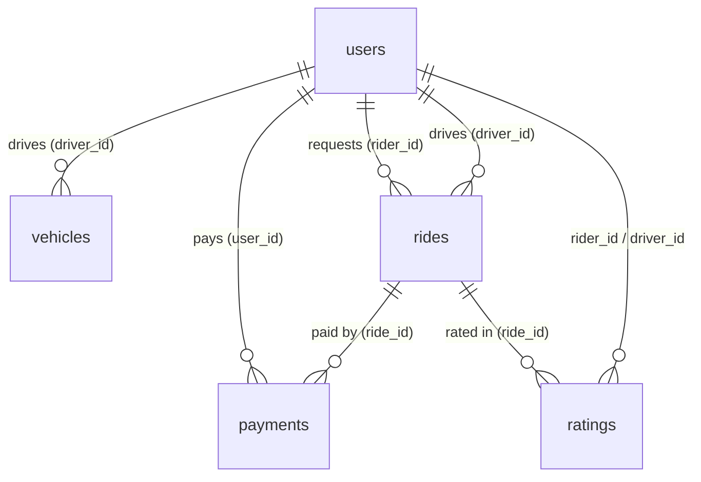

| Table | Rows | What it holds |
|---|---|---|
| `users` | 10,000 | riders (7,000) **and** drivers (3,000), told apart by `user_type` |
| `vehicles` | 3,000 | one per driver: make, model, year, plate, colour |
| `rides` | 20,000 | times, GPS coordinates, distance, fare, surge, `status` (completed / cancelled / in_progress / requested) |
| `payments` | 16,073 | amount, `payment_method`, `payment_status`, transaction id |
| `ratings` | 12,000 | 1–5 stars + comment, linking rider, driver and ride |

Questions to try:

- *Which 5 drivers have the highest average rating?*
- *What is the average fare by city?*
- *What percentage of rides were cancelled, and what are the most common reasons?*
- *Which payment method brings in the most revenue?*

The ETL Analyst uses a different source: the public [PokéAPI](https://pokeapi.co), which needs no key.

---

## 5. Agent 1: Data Agent (router)


As LangGraph draws it from the code (`img/data_agent_graph.png`):


**State** (`DataAgentSchema`): `messages` (the conversation) and `route_response` (`"sql"` or `"etl"`).

| # | Node | What it does | LLM |
|---|---|---|---|
| 1 | `router_node` | Classifies the request. The reply is forced into `RouteSchema`, so `answer` can only be `"sql"` or `"etl"`. | advanced |
| 2a | `sql_node` | Builds the SQL Analyst's starting state (`user_input` = your request), runs the whole SQL graph, and adds its `final_answer` as an `AIMessage`. | (inside) |
| 2b | `etl_node` | Runs the whole ETL graph with your request and adds its last message. | (inside) |

The branch is a **conditional edge**: `route_edge` reads `state.route_response` and returns `"sql_node"` or `"etl_node"`. Any other value raises an error on purpose, so a bad value fails loudly instead of quietly going down the wrong branch.

**Why route first?** Each specialist stays simple and focused. Adding a new skill later (for example, "make a chart") means adding a new branch, without touching the others.

---

## 6. Agent 2: SQL Analyst (workflow)

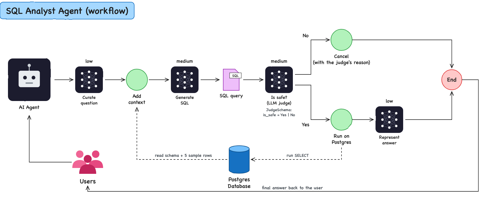

As LangGraph draws it from the code (`img/sql_analyst_graph.png`):

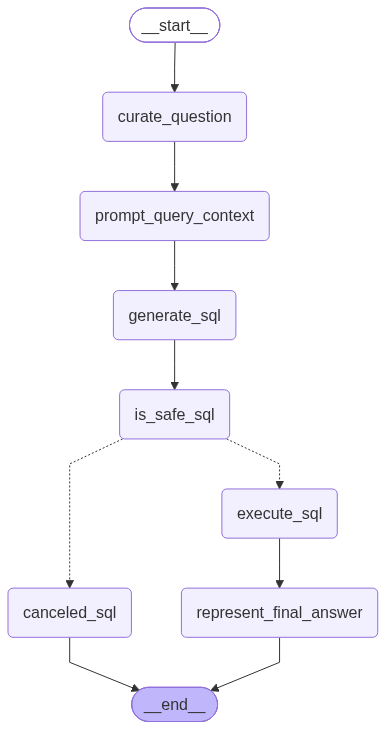

```
START
  -> curate_question        LLM (low)      rewrite the question clearly
  -> prompt_query_context   no LLM         build a prompt with the DB schema + sample rows
  -> generate_sql           LLM (medium)   write the SQL query
  -> is_safe_sql            LLM (medium)   judge: is the query read-only?
       |-- "Yes" -> execute_sql                  run it on Postgres
       |              -> represent_final_answer  LLM (low) explain the result
       |              -> END
       |-- "No"  -> canceled_sql                 stop and explain why
                      -> END
```

All nodes share one **state** object (`AgentSchema` in `models/schema.py`). Each node reads what it needs and returns a dict with only the fields it changed.

| # | Node | Reads | Writes | LLM | Why |
|---|---|---|---|---|---|
| 1 | `curate_question` | `user_input` | `curated_question`, `messages` | low | Vague questions make bad SQL. Rewording is easy, so a cheap model is enough. |
| 2 | `prompt_query_context` | `curated_question` | `prompt_query_context` | — | Pulls tables, columns, types and 5 sample rows per table from Postgres and puts them in the prompt. **This is what makes the SQL correct.** |
| 3 | `generate_sql` | `prompt_query_context` | `generated_sql_query` | medium | The hardest step: needs correct joins, filters, aggregations. |
| 4 | `is_safe_sql` | `generated_sql_query` | `is_safe`, `comments` | medium | A second LLM acts as a judge: is the query read-only? |
| 5a | `canceled_sql` | `comments` | `final_answer`, `messages` | — | "No" branch: stop and explain why. |
| 5b | `execute_sql` | `generated_sql_query` | `sql_query_execution_result` | — | "Yes" branch: run on Postgres. Errors come back as text. |
| 6 | `represent_final_answer` | result + question | `final_answer`, `messages` | low | Turns `[('apple_pay',), ...]` into a friendly sentence. |

---

## 7. Agent 3: ETL Analyst (ReAct loop)

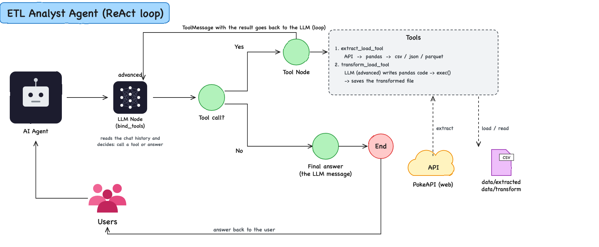

As LangGraph draws it from the code (`img/etl_analyst_graph.png`):


**ETL** = **E**xtract (get data from somewhere), **T**ransform (change it), **L**oad (save it somewhere).

**State** (`ETLAgentSchema`): only `messages`. A tool-calling agent keeps everything in the conversation: the request, the tool calls, the tool results and the answer.

### The two nodes

| Node | What it does |
|---|---|
| `llm_node` | Sends the chat history to an LLM that has the tools **bound** to it (`bind_tools`). The LLM either answers normally or replies with `tool_calls` (which tool, with which arguments). |
| `tool_node` | Runs every requested tool and wraps each result in a `ToolMessage`. Then it goes **back** to `llm_node`. That edge is what makes it a loop. |

After `llm_node`, the router `is_tool_call` checks: *are there tool calls?* Yes → `tool_node`. No → `END` (that last message is the final answer).

### The two tools

| Tool | Steps |
|---|---|
| `extract_load_tool(url, output_folder, format)` | `requests.get(url)` → `pd.json_normalize(...)` (the `"results"` list if there is one, otherwise the whole reply) → save as csv / json / parquet |
| `transform_load_tool(input_file_path, output_folder, output_format, user_question)` | turn the paths into full paths from the project root → read the first 3 rows of the file → a **second LLM** writes pandas code → remove the Markdown fence → `exec()` the code, which saves the new file → report clearly whether it worked or failed |

### A real run, message by message

Request: *"Transform `data/extracted/extracted_data.csv` to show bulbasaur only, save it in `data/transform` as csv."*

```
1. HumanMessage   the request
2. AIMessage      tool_calls=[transform_load_tool(input_file_path="data/extracted/extracted_data.csv",
                                                  output_folder="data/transform", output_format="csv", ...)]
                  -> is_tool_call: yes -> tool_node
3. ToolMessage    "The data is transformed and saved at data/transform ... Pandas Code Executed: ..."
                  -> back to llm_node
4. AIMessage      "The data was filtered to Bulbasaur and saved as data/transform/transformed_data.csv"
                  (no tool_calls) -> is_tool_call: no -> END
```

The LLM called a tool, read the result and decided it was done. It made those choices itself; no code told it to. That's the ReAct pattern.

---

## 8. Learning notes

### 1. What makes this an "agent" and not just one LLM call?

A single prompt like *"write SQL for this question"* often fails: the model guesses table names, nothing checks its output, and you get raw tuples back. An agent splits the job into **steps**, each with one job, and adds **decisions** (branches and loops). Each step is small, testable, and can use a different model.

### 2. LangGraph basics

| Concept | In this project |
|---|---|
| **State** | A Pydantic model that every node receives (`AgentSchema`, `ETLAgentSchema`, `DataAgentSchema`) |
| **Node** | A plain Python function `state -> dict` |
| **Edge** | `add_edge("a", "b")`: after `a`, always run `b` |
| **Conditional edge** | `add_conditional_edges("a", router_fn, ...)`: a router function picks the next node |
| **Loop** | An edge that points back to an earlier node (`tool_node -> llm_node`) |
| **START / END** | Special entry and exit points |
| **compile()** | Checks the graph and returns a runnable with `.invoke()` |
| **Sub-graph** | A compiled graph called from inside another graph's node |
| **draw_mermaid_png()** | Renders the graph as an image (saved in `img/`) |

**State: one shared notebook.** Every node gets the whole state, but returns only the fields it changed. LangGraph merges that into the state and passes it on. In the SQL Analyst, the notebook fills up like this:

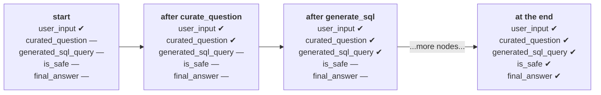

**Reducers: how updates are merged.** By default, a field a node returns *replaces* the old value. A field declared as `Annotated[list, add]` gets the new list *appended* instead:

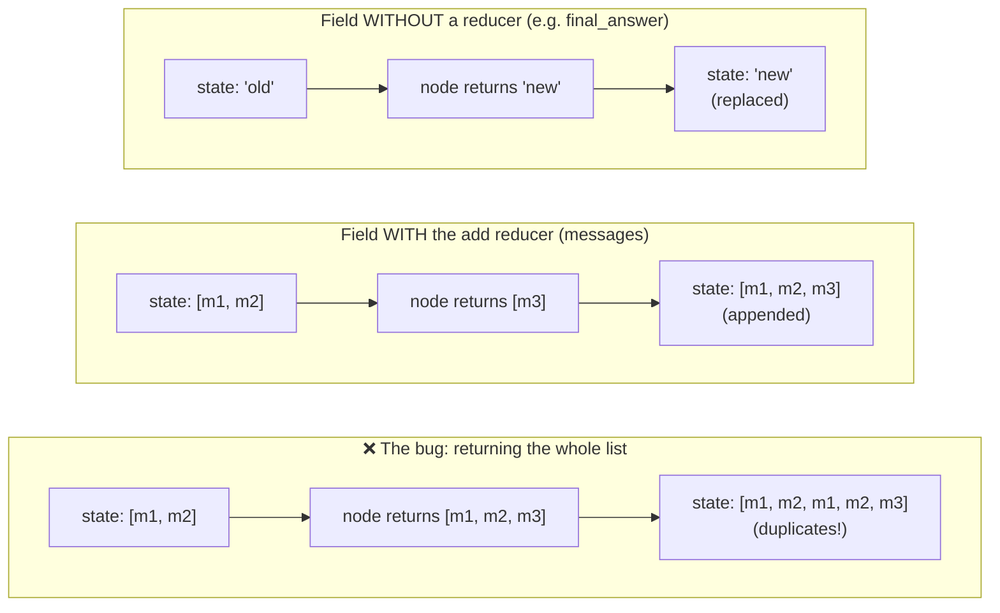

```python
messages: Annotated[list, add]          # in the state model

return {"messages": [AIMessage("hi")]}  # in a node: the new message is appended
```

That's why a node must return **only the new messages**. If it returned the whole list, everything would be appended again. This exact bug happened in all three agents (see the debugging journal).

**Two ways to write a conditional edge:**

```python
# a list: the router returns the node name directly (sql_analyst.py)
add_conditional_edges("is_safe_sql", is_safe_condition, ["execute_sql", "canceled_sql"])

# a dict: the router returns a key, and the dict maps it to a node (etl_analyst.py)
add_conditional_edges("llm_node", is_tool_call, {"tool_node": "tool_node", "end": END})
```

### 3. Tool calling: how an LLM "uses" a function

The LLM never runs your code. What happens:

1. `@tool` turns a Python function into a tool. Its **name**, **docstring** and **type hints** become a description.
2. `llm.bind_tools(tools)` sends those descriptions along with every request.
3. The LLM can reply with `tool_calls=[{"name": "extract_load_tool", "args": {...}, "id": "call_1"}]`. That reply is a *request* to call the tool.
4. **Your** `tool_node` runs the function and returns a `ToolMessage(content=result, tool_call_id="call_1")`.
5. The LLM reads the result in its next turn.

The docstring is part of the prompt, so a clear docstring means the LLM picks the right tool with the right arguments.

The same flow as a timeline:

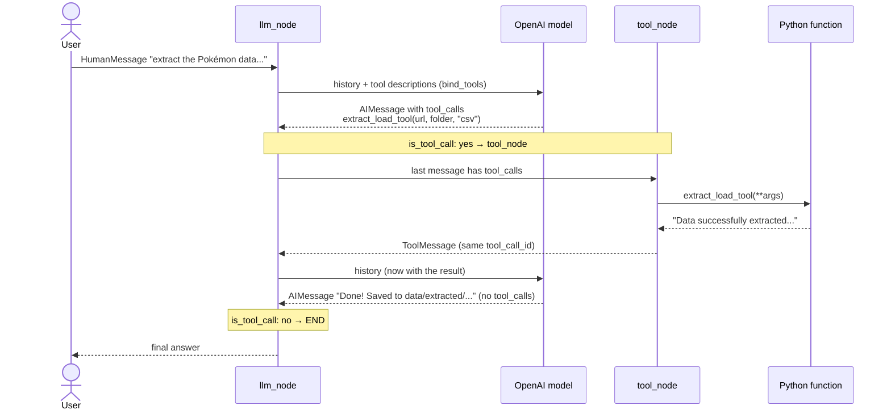

### 4. Message types

| Type | Who says it | Example |
|---|---|---|
| `HumanMessage` | the user | "Extract the Pokémon data..." |
| `AIMessage` | the LLM | a text answer, **or** a list of `tool_calls` |
| `ToolMessage` | your code, after running a tool | "Data successfully extracted and saved to ..." |

`.content` is usually a string, but newer OpenAI models can return a **list of blocks** (`[{"type": "text", "text": "..."}]`). `.text` always gives you a plain string. That's why the ETL tool uses `.text`.

### 5. Pydantic: typed state and validation

- `BaseModel` checks data when an object is created. A wrong type raises `ValidationError` right away, instead of a mystery bug three nodes later.
- `Field(...)` means the field is required. `Field(None)` means it's optional and starts as `None`.
- `Literal["Yes", "No"]` allows exactly those two strings, nothing else.
- LangGraph checks the **starting input** against the state model too, so every required field needs a starting value (that's why the runs start with `"route_response": ""`).

### 6. Structured output: making LLM answers machine-readable

```python
llm_judge  = llm.with_structured_output(JudgeSchema)   # SQL Analyst
llm_router = llm.with_structured_output(RouteSchema)   # Data Agent

llm_router.invoke("Download the Pokémon data")   # -> RouteSchema(answer="etl", comments="...")
```

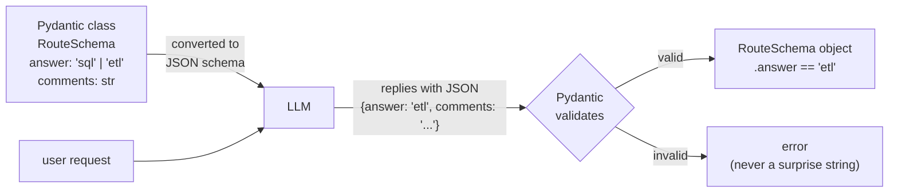

Instead of parsing free text (*"I think this is probably about ETL..."*), LangChain sends the Pydantic schema to the model and turns the reply back into an object. The `description=` of each field is sent too, **and so is the class docstring**, so both act as instructions. `.model_dump()` turns the object into a dict.

### 7. Context is everything (prompt engineering)

The LLM has never seen your data. Both agents give it context first:

- **SQL**: tables, columns, types and **5 sample rows** per table (open `schema_details.txt` to see it)
- **ETL**: the **first 3 rows** of the file before it writes pandas code

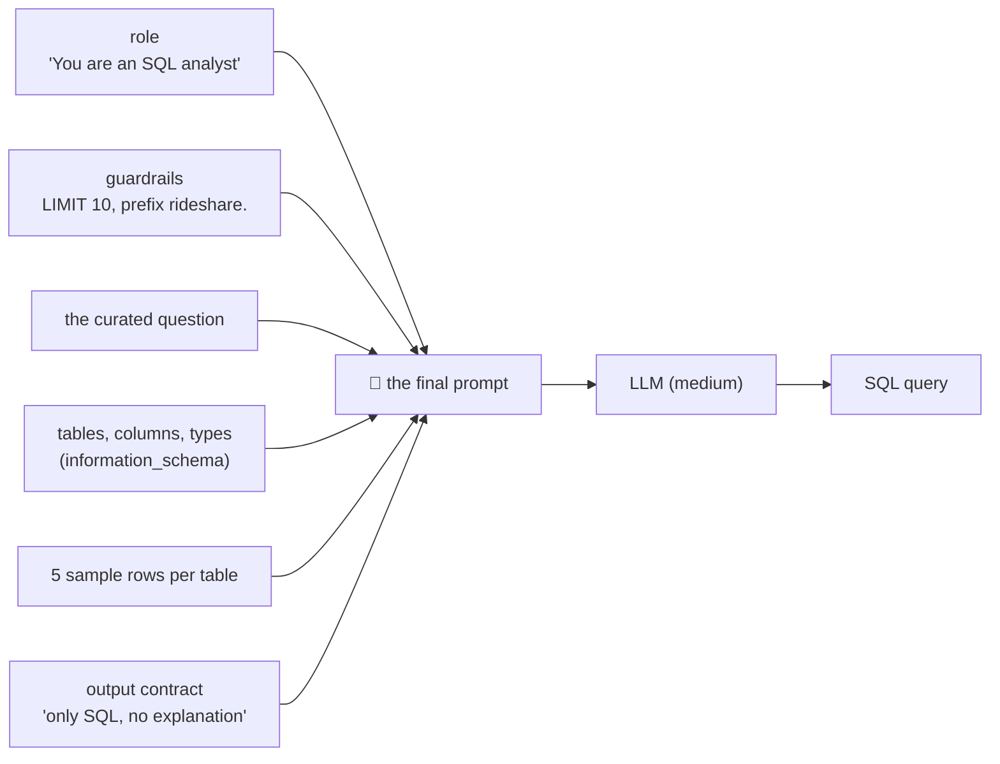

Sample values teach the exact spelling (`'credit_card'` not `'Credit Card'`), formats and column names. Each prompt also has:

- **a role**: "You are an SQL analyst agent"
- **guardrails**: `LIMIT 10` by default, prefix tables with `rideshare.`
- **an output contract**: "only SQL / only code, no explanation", because the reply is run as-is

### 8. LLM-as-a-judge and defence in depth

`is_safe_sql` uses a second LLM call to review the first one's output. It's a useful pattern (it also gives a human-readable reason), but **an LLM is not a security boundary**: it can be fooled or make mistakes. Real protection uses layers:

1. a database user with **read-only** (`SELECT`-only) permissions ← the strongest layer
2. a simple code check (e.g. reject anything that isn't a single `SELECT` / `WITH`)
3. the LLM judge for the fuzzy cases and the explanation
4. statement timeouts and row limits

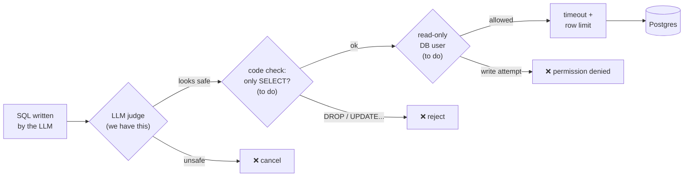

Each layer catches what the one before it missed. The read-only user is the only layer that **cannot** be talked out of its rule.

### 9. Model tiering (cost vs quality)

`pick_llm(level)` maps a level to a model, so each step uses the cheapest model that does it well:

| Level | Model | Used for | Why |
|---|---|---|---|
| `low` | `gpt-5.6-luna` | rewording the question, writing the final SQL answer | easy language tasks |
| `medium` | `gpt-5.6-terra` | writing SQL, judging safety | reasoning, must be correct |
| `advanced` | `gpt-5.6-sol` | the router, the ETL agent, writing pandas code | choosing tools and writing code |

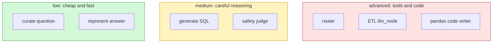

All use `temperature=0` (answers as repeatable as possible) and `reasoning_effort="none"` (no hidden "thinking" step, so they're faster and cheaper). `pick_llm` takes a **level**, not a model name: `pick_llm("gpt-5.6-sol")` raises a `ValueError`.

### 10. PostgreSQL concepts used here

- **Schema**: a namespace inside a database. Our tables are `rideshare.users`, `rideshare.rides`, …
- **search_path**: the list of schemas Postgres searches for names without a schema. The default is `public`, so `FROM payments` fails unless you write `rideshare.payments` or set `search_path=rideshare,public` (which `execute_sql` does).
- **information_schema**: built-in views that describe the database itself (tables, columns, types). Used to build the LLM context. `ordinal_position` gives the column order.
- **Primary / foreign keys, UNIQUE, CHECK**: rules Postgres enforces on every row (see `feed_db.py`).
- **Indexes**: speed up lookups and joins on the indexed columns.
- **COPY**: bulk-loads a CSV in one go, much faster than thousands of `INSERT`s.
- **Transactions**: `feed_db.py` turns autocommit off, so all loads are saved together by `conn.commit()`, or none are.
- **Connection vs cursor** (psycopg2): the connection is the session; the cursor sends SQL and holds results (`fetchall()` → list of tuples, `fetchone()` → one tuple).

### 11. pandas concepts used here

- **DataFrame**: a table with named columns, like a sheet in Excel.
- **`pd.json_normalize`**: flattens nested JSON (`{"results": [{"name": ..., "url": ...}]}`) into rows and columns.
- **`read_csv` / `read_json` / `read_parquet`** and **`to_csv` / `to_json` / `to_parquet`**: read and write the three formats. Parquet is a compressed, typed format that's common in data engineering.
- **`df.head(3)`**: the first 3 rows. `index=False`: don't save pandas' row numbers as a column.

### 12. Python notes

- **`sys.path.append(...)`** in `agents/*.py` lets a script inside `agents/` import `utils` and `models` from the project root (explained step by step at the top of `sql_analyst.py`). It's a workaround; cleaner alternatives are `python -m agents.sql_analyst` or installing the project as a package. `main.py` doesn't need it because it's already in the root.
- **`**dict`** unpacks a dict into keyword arguments: `psycopg2.connect(**{"host": "x"})` is the same as `psycopg2.connect(host="x")`.
- **`try / except / finally`**: `finally` always runs, so it's the right place to close cursors and connections.
- **f-strings in SQL**: fine for values your code controls (the schema name), dangerous for user input (SQL injection). `feed_db.py` shows the safe way: `psycopg2.sql.Identifier`.
- **`if __name__ == "__main__":`**: code that runs only when the file is executed directly, not when it's imported. Each agent compiles its graph **outside** this block, so other files can import it.
- **Paths**: `os.path.join(os.path.dirname(__file__), "..", "img", ...)` builds a path from the file's own location, so it works from any folder. A plain `"data/extracted"` is relative to the folder you run from.

### 13. Running LLM-generated code: `execute_code` and production

`ETLTools.execute_code` (in `utils/etl_tools.py`) calls `exec(code)`. That code runs **inside the same Python process as the agent, on our server**, with the same permissions. It can:

- read `.env` and `os.environ` (OpenAI key, Postgres password)
- read, change or delete any file the process can reach
- open network connections (send data out, call internal services)
- install packages, start processes, use all the CPU/RAM, or loop forever and freeze the agent

That's fine for learning on your own machine. In production, the code comes from an LLM, and the LLM's input comes from users (and from API data), so a prompt injection can turn into arbitrary code running on the server. **Never `exec` LLM code in the app process in production.**

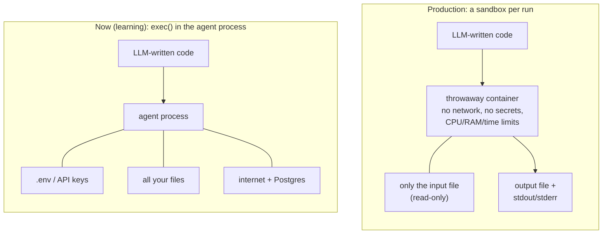

**How to do it in production: run the code in a sandbox, not on the server.**

| Option | What it is | When to pick it |
|---|---|---|
| Managed sandbox ([E2B](https://e2b.dev), [Modal](https://modal.com) sandboxes, [Daytona](https://daytona.io)) | an API call creates an isolated micro-VM, runs the code, returns stdout/files, destroys the VM | the easiest secure option; good default |
| Docker container per run | `docker run` a throwaway container with no network, read-only filesystem, CPU/RAM/time limits | you host everything yourself |
| gVisor / Firecracker | stronger isolation than plain Docker (a container shares the host kernel) | many untrusted users, higher risk |
| Don't run code at all | the LLM picks from fixed tools (`filter_rows`, `select_columns`, …) with typed arguments | when the tasks are predictable; the safest option |

`RestrictedPython`, removing `__builtins__`, or a blocklist of words like `import os` **is not a sandbox**: there are well-known ways around all of them.

Example with Docker (each run gets a new container, which is thrown away at the end):

```python
import subprocess

def execute_code(code: str, data_dir: str) -> str:
    result = subprocess.run(
        [
            "docker", "run", "--rm",
            "--network", "none",              # no internet, no access to Postgres/internal services
            "--memory", "512m", "--cpus", "1",
            "--pids-limit", "64",
            "--read-only",                    # filesystem is read-only...
            "--tmpfs", "/tmp:size=64m",       # ...except a small /tmp
            "-v", f"{data_dir}:/data:ro",     # only the data it needs, read-only
            "--user", "1000:1000",            # not root
            "python-sandbox:latest",          # image with only pandas etc., no secrets
            "python", "-c", code,
        ],
        capture_output=True, text=True, timeout=30,
    )
    return result.stdout if result.returncode == 0 else f"Error: {result.stderr}"
```

Production checklist:

1. **Isolation**: separate VM/container per run, destroyed afterwards; never the agent's own process.
2. **No secrets inside**: no `.env`, no API keys, no DB credentials in the sandbox.
3. **No network** by default; if it's needed, an allowlist of domains.
4. **Limits**: timeout, memory, CPU, number of processes, output size.
5. **Least data**: mount only the files that run needs, read-only; outputs go to a separate folder you check before using them.
6. **Return the output**: capture stdout/stderr (the current `exec` version only returns "Code executed successfully", so the agent never sees the result).
7. **Logging**: store each piece of code that ran, who asked for it and the result, so you can audit it.
8. **Human approval** for anything that writes to real systems (DB, cloud storage).

---

## 9. Debugging journal: bugs found and what they taught

| Symptom | Cause | Fix | Lesson |
|---|---|---|---|
| `schema_details.txt` was **3.7 GB**, full of repeated `Database Schema: rideshare` | `text += f"{text}..."` adds the whole string to itself on every line, so it **doubles** each time (2³⁰ ≈ 1 billion) | `text += f"..."` | `+=` already keeps the old value; don't also put it inside the f-string. |
| Sample row values didn't line up with column names | `information_schema.columns` has no guaranteed order | `ORDER BY ordinal_position` | SQL never guarantees row order without `ORDER BY`. |
| Columns from other schemas could appear | column query filtered by `table_name` only | added `AND table_schema = '...'` | the same table name can exist in several schemas. |
| `ValidationError: is_safe Input should be 'Yes' or 'No'` before the first node | initial input had `is_safe: ""`, which isn't allowed by `Literal["Yes","No"]` | made it `Literal[...] \| None = None` | LangGraph validates the input against the state model; fields filled later must allow an empty start value. |
| Conversation history full of duplicates (in all three agents) | nodes returned the **whole** state; the `add` reducer appended the full `messages` list again | nodes return a dict of **only the changed fields** | understand your reducers: return only what changed, never the full state. |
| A failed query would crash the graph | `execute_query` returned `None` on error, but the field is `str` | return `"Error executing query: ..."` | keep return types consistent; returning errors as text lets the agent explain them. |
| `relation "payments" does not exist` | LLM wrote `FROM payments`; Postgres looked in `public` | `search_path=rideshare,public` + prompt tells LLM to prefix with `rideshare.` | fix it with a fixed rule in code, and also guide the LLM. |
| `ValueError: Invalid level provided` | `pick_llm("gpt-5.6-sol")` passed a model name instead of a level | `pick_llm("advanced")` | read the function's contract; the error message also listed outdated names, which made it confusing. |
| `AttributeError: 'list' object has no attribute 'strip'` | the `advanced` model returns `.content` as a list of blocks, not a string | use `.text` | don't assume `.content` is a string; `.text` is the safe accessor. |
| ETL saved to the wrong place / file not found | Windows paths (`c:\\...`) in the prompt on a Mac | relative paths (`data/extracted/...`) | paths in prompts end up in code; keep them portable and relative to the project root. |
| `ImportError: cannot import name 'RouterSchema'` | the class is called `RouteSchema` | fix the import | names must match exactly; your editor's autocomplete helps. |
| `ImportError` for `sql_analyst` from `data_agent.py` | the graph was compiled only inside `if __name__ == "__main__":` | compile at module level | code under `__main__` doesn't run on import. |
| SQL sub-graph rejected its input | `sql_node` used field names that don't exist (`user_question`, `curated_ques`) | use `user_input`, `curated_question` | the input dict must match the sub-graph's state model exactly. |
| LangChain warning about `reasoning_effort` | it was passed inside `model_kwargs` | pass it as a direct argument | read warnings; they often point to an API that changed. |
| Generated code starting with `pd.` or `open(` would break (`d.read_csv`) | `lstrip('python')` removes any of the *characters* p, y, t, h, o, n, not the word | `removeprefix("```python")` | `strip`/`lstrip` take a set of characters; use `removeprefix`/`removesuffix` for text. |
| The agent said "transformed and saved" even when the pandas code crashed | the tool's message always started with the success text | return a clear "FAILED, nothing was saved" message | the LLM believes what tools tell it; tool messages must be honest. |
| A different API crashed the whole graph with `KeyError: 'results'` | only network errors were caught | handle lists/objects without `"results"`, catch other errors as text | catch the errors you can predict, and return them as text. |
| Output landed in the wrong folder when run from elsewhere | the generated code used paths relative to the current folder | `ETLTools.resolve_path` turns them into full paths from the project root | relative paths depend on *where you run*, not where the file is. |
| A **folder** named `result.json` appeared | the LLM passed a file path as `output_folder`, and the code created it as a folder | if the path has an extension, create its parent folder | LLM arguments are guesses; check them before acting on them. |
| A DB connection failure showed a confusing `NameError`/`AttributeError` | `cursor` was used in `finally` before it existed | check the connection first, start `cursor = None` | in `try/finally`, every name used in `finally` must exist on every path. |

---

## 10. Known limitations and next steps

**Limitations**

- The schema name `rideshare` is hard-coded in `prompt_query_context` and `execute_sql`.
- The whole schema (+ sample rows) is sent on every question. Fine for 5 tables, too big for 500.
- The LLM judge is the only safety layer; there's no read-only DB user yet.
- `ETLTools.execute_code` runs LLM code with `exec` inside the agent process: OK locally, not safe in production (see [note 13](#13-running-llm-generated-code-execute_code-and-production)).
- The ETL loop has no maximum number of turns besides LangGraph's default recursion limit.
- No retry: if the SQL fails, the agent explains the error but doesn't try to fix it.
- Each run starts from scratch: there's no memory between requests.
- A new DB connection is opened for every call, and `DatabaseUtil` closes it after one method call.
- `OPENAI_MODEL` in `.env` isn't used.

**Ideas**

- **Self-correction loop**: if `execute_sql` returns an error, send the error back to `generate_sql` (a conditional edge pointing backwards), with a maximum of N retries.
- **Read-only Postgres role** for the agent.
- **Schema retrieval (RAG)**: pick only the tables relevant to the question before building the prompt.
- **Conversation memory**: use a LangGraph checkpointer so follow-ups like *"and by city?"* work.
- **Sandbox** for the generated pandas code (note 13).
- **Interface**: a CLI loop in `main.py`, or a small Streamlit/Gradio app.
- **Evaluation**: a set of questions with known answers to measure accuracy when changing prompts or models.
- **More routes**: e.g. a "chart" specialist that turns a result into a plot.

---

## 11. Glossary

| Term | In simple terms |
|---|---|
| **LLM** | Large Language Model: the AI that reads text and writes text (here, OpenAI models). |
| **Agent** | A program where an LLM takes part in deciding *what to do*, not only *what to write*. |
| **Prompt** | The text you send to the LLM: instructions plus context. |
| **Context** | The extra information in the prompt that the LLM doesn't know on its own (DB schema, sample rows). |
| **Graph** | The agent's map: boxes (nodes) connected by arrows (edges). |
| **Node** | One step: a Python function that gets the state and returns what it changed. |
| **Edge** | An arrow: "after this step, go to that one". |
| **Conditional edge** | A fork in the road: a small function looks at the state and picks the next step. |
| **State** | The shared notebook every step reads from and writes to. |
| **Reducer** | The rule for merging a step's output into the state (replace, or append for `add`). |
| **Sub-graph** | A whole agent used as a single step inside another agent. |
| **Router** | A step that decides which path or specialist should handle a request. |
| **Tool** | A Python function the LLM is allowed to ask for (it asks; your code runs it). |
| **ReAct** | Reason + Act: the LLM thinks, calls a tool, sees the result, and repeats until done. |
| **Structured output** | Forcing the LLM to answer in a fixed shape (a Pydantic model) instead of free text. |
| **LLM-as-a-judge** | Using a second LLM call to check the first one's work. |
| **ETL** | Extract (get data), Transform (change it), Load (save it). |
| **Sandbox** | An isolated, throwaway environment where untrusted code can't harm the real system. |
